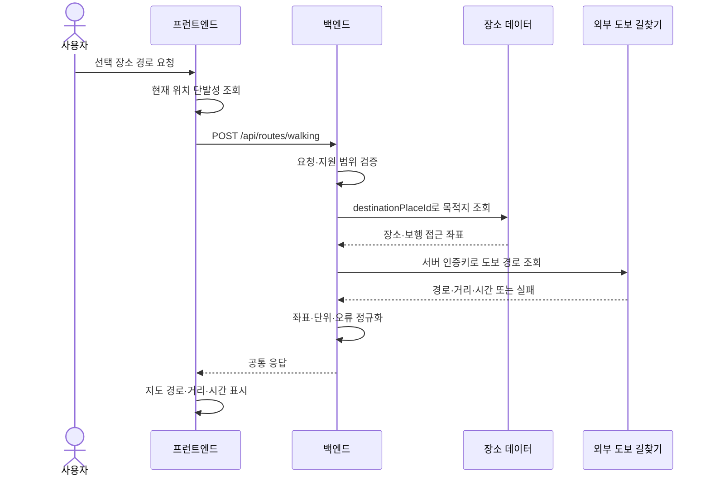

# 도보 경로안내 — 백엔드 전달 문서

작성 기준: 2026-11-06 · 상태: **FE/BE 협의용 제안, 미구현**

## 1. 전달 요약

프런트엔드는 현재 위치와 선택한 장소 ID를 보내고, 백엔드는 해당 장소까지의 **실제 도보 경로 좌표·총거리·예상 소요 시간**을 반환하는 구조를 제안한다. 프런트엔드는 반환된 좌표를 네이버 지도에 선으로 그린다.

백엔드에 요청하는 핵심 작업은 다음과 같다.

1. 출발 좌표와 목적지 장소를 검증한다.
2. 목적지의 보행 접근 지점 또는 입구 좌표를 서버 데이터에서 결정한다.
3. 서버에서 외부 도보 길찾기 API를 호출한다.
4. 제공사 응답을 아래 공통 형식으로 정규화한다.
5. 경로 없음·제공사 장애·시간 초과를 구분해 응답한다.
6. 사용자 출발 좌표를 DB·로그·추적 시스템에 저장하지 않는다.

아래 엔드포인트·필드·오류 코드는 **새로 제안하는 계약**이다. 기존 백엔드에 구현되어 있거나 요구서에서 확정된 계약으로 보아서는 안 된다. 외부 제공사와 구체적인 호출 스펙도 아직 확정되지 않았다.

## 2. 현재 코드에서 확인되는 범위

| 항목 | 현재 상태 | 근거 |
| --- | --- | --- |
| 지도·거리뷰 | NAVER Maps JS SDK 로더와 파노라마 사용 | `src/platform/map.ts` |
| 좌표 타입 | 위치는 `{ lat, lng }`, 지도 경로는 `[lng, lat]` | `src/platform/location.ts`, `src/platform/map.ts` |
| 위치 조회 | 웹·네이티브에서 단발성 조회, 10초 제한 | `src/platform/location.ts` |
| 지도 선 | 고정 근사 좌표 3개를 `Polyline`으로 연결 | `src/app/dev/map-check/page.tsx` |
| 실제 길찾기 | API 호출·보행 경로 계산·거리·시간·안내 화면 없음 | 현재 `src/` 코드 |
| 외부 길찾기 키 | `SKT_ACCESS_KEY_ID` 예시만 있고 미사용 | `.env.example` |
| API 공통 처리 | `/api` 프록시, 공통 응답에서 `data` 반환 | `src/api/client.ts`, `next.config.ts` |
| 목 | health·익명 사용자 생성만 지원. 경로 목 없음 | `src/mocks/handlers.ts` |

**현재 화면의 선은 실제 보행 가능한 경로가 아니다.** 거리뷰 조회 성공도 보행 경로 존재나 접근 가능성을 보장하는 근거로 사용하지 않는다. 네이버 지도 렌더링과 실제 길찾기 계산은 별도 책임으로 둔다.

관련 문서: [아키텍처](ARCHITECTURE.md), [하네스 엔지니어링](HARNESS_ENGINEERING.md), [Figma 디자인](https://www.figma.com/design/LiOMcefG48DP23YjkXeLgg/Untitled?node-id=0-1&t=5vN8C4Fc3uBkVfOp-1).

이 문서는 현재 코드와 기존 아키텍처 문서의 요구사항 정리를 기준으로 작성했다. 이전에 참조한 상위 `요구서.md`는 이번 확인 시 해당 경로에 없어 원문 변경 여부를 재확인하지 못했다. Figma의 특정 경로안내 화면이 승인되었다고 가정하지 않는다.

## 3. 제안 범위와 사용자 흐름

첫 연동 범위는 **출발지 1개 → 선택한 장소 1개**의 도보 경로 미리보기다. 여러 장소의 방문 순서는 코스 데이터로 관리하며 길찾기 API가 임의로 재정렬하지 않는다.

1. 사용자가 장소를 선택하고 경로안내를 요청한다. 버튼 위치·문구는 화면 구현 시 결정한다.
2. 프런트엔드가 현재 위치를 한 번 조회한다. 이미 받은 위치를 재사용할 경우 최신성 기준을 합의한다.
3. 좌표를 얻으면 아래 경로 API를 호출한다.
4. 지도에 실제 경로를 표시하고 총거리·예상 도보 시간을 보여준다.
5. 사용자가 명시적으로 다시 요청하면 위치를 다시 조회하고 경로를 갱신한다.

위치 권한 거부·조회 실패 시 API를 호출하지 않고 재시도 또는 합의된 출발지 선택을 제공한다. 역 선택 대체 흐름은 요구서와 Figma의 차이가 남아 있으므로 확정이 필요하다. 사용자 동의 없이 임의 위치를 현재 위치로 대체하지 않는다.

지속 GPS 추적, 경로 이탈 자동 감지·재탐색, 음성 안내, 대중교통·차량 경로, 다중 경유지 최적화는 이번 제안 범위에 포함하지 않는다. 단계별 회전 안내는 첫 응답에 필수로 넣지 않으며 필요하면 별도 합의한다.



## 4. 제안 API 계약

### 요청

`POST /api/routes/walking`

`Content-Type: application/json`

좌표를 URL 쿼리에 넣지 않기 위해 JSON 본문으로 요청한다. POST 본문도 서버·프록시·APM 설정에 따라 기록될 수 있으므로 본문 로그를 별도로 차단해야 한다.

```json
{
  "origin": {
    "lat": 37.5742,
    "lng": 126.9578
  },
  "destinationPlaceId": "seodaemun-prison"
}
```

| 필드 | 필수 | 설명 |
| --- | --- | --- |
| `origin.lat` | 예 | 유한한 숫자, 위도 `-90`~`90` |
| `origin.lng` | 예 | 유한한 숫자, 경도 `-180`~`180` |
| `destinationPlaceId` | 예 | 서버가 관리하는 장소 ID. 예시 문자열은 실제 ID로 교체 |

좌표계는 **WGS84 경위도**로 통일하는 계약을 제안한다. 숫자 문자열·`null`·누락값을 임의로 0으로 바꾸지 않는다. 사용자가 보낸 목적지 좌표·외부 URL을 그대로 신뢰하는 입력은 받지 않는다. 경로 조회에는 사용자 ID·방문 기록을 필수로 요구하지 않는 안이며, 인증 정책은 기존 서버 정책과 합의한다.

### 성공 응답

아래 좌표·거리·시간은 **형식 설명용 가상 값**이다. 실제 경로·측정치·외부 API 결과로 사용하지 않는다.

```json
{
  "resultType": "SUCCESS",
  "httpStatusCode": 200,
  "code": "ROUTE_FOUND",
  "message": "도보 경로를 조회했습니다.",
  "data": {
    "mode": "WALKING",
    "destination": {
      "placeId": "seodaemun-prison",
      "name": "서대문형무소역사관",
      "lat": 37.5748,
      "lng": 126.9563
    },
    "distanceMeters": 320,
    "durationSeconds": 300,
    "geometry": {
      "type": "LineString",
      "coordinates": [
        [126.9578, 37.5742],
        [126.9575, 37.5744],
        [126.9563, 37.5748]
      ]
    }
  }
}
```

| 필드 | 계약 |
| --- | --- |
| `mode` | 첫 버전은 `WALKING` |
| `destination` | 서버가 확정한 장소와 길찾기에 사용한 보행 접근 좌표. 장소 중심점과 다를 수 있음 |
| `distanceMeters` | 제공사 보행 경로의 총거리. 유한한 0 이상의 숫자, 미터 단위 |
| `durationSeconds` | 제공사 예상 도보 시간. 유한한 0 이상의 숫자, 초 단위 |
| `geometry.type` | 첫 버전은 `LineString` |
| `geometry.coordinates` | 출발 → 도착 순서의 연속 좌표 배열, 최소 2점, 각 점은 `[경도, 위도]` |

원시 제공사 응답 대신 이 형식으로 통일한다. 배열의 위도·경도를 뒤집거나 거리·시간 단위를 화면별로 다르게 해석하지 않는다. 시간·거리의 사용자 표시 단위와 반올림은 FE 책임이다. 최단 경로·장애물 없는 경로·실시간 도착 보장을 뜻하는 문구는 제공사 근거 없이 붙이지 않는다.

요청 출발점이 보행 네트워크에 보정될 수 있으므로 첫·마지막 경로점이 요청 좌표·장소 좌표와 완전히 같다고 강제하지 않는다. 큰 보정 거리의 허용 기준은 제공사 선택 후 합의하며, 출발점과 선 사이를 임의 직선으로 이어 실제 경로처럼 표시하지 않는다.

### 오류 응답

HTTP 상태와 본문의 `httpStatusCode`를 일치시키고 기존 공통 응답 형식을 유지한다. 실패 시 `data`는 `null`로 제안한다. FE의 `api()`는 이를 `ApiError`로 전달한다.

```json
{
  "resultType": "FAILURE",
  "httpStatusCode": 422,
  "code": "WALKING_ROUTE_NOT_FOUND",
  "message": "해당 장소까지의 도보 경로를 찾을 수 없습니다.",
  "data": null
}
```

| HTTP | 제안 코드 | 의미·FE 처리 |
| --- | --- | --- |
| 400 | `INVALID_ROUTE_REQUEST` | 필수값·좌표 형식 오류. 입력 수정 전 자동 재시도하지 않음 |
| 404 | `PLACE_NOT_FOUND` | 존재하지 않거나 서비스에서 제공하지 않는 장소 |
| 422 | `ORIGIN_OUT_OF_SERVICE_AREA` | 형식은 맞지만 지원 지역 밖 출발지. 지원 지역 정책 합의 필요 |
| 422 | `DESTINATION_NOT_ROUTABLE` | 장소에 유효한 보행 목적지 좌표가 없음 |
| 422 | `WALKING_ROUTE_NOT_FOUND` | 경로 없음 또는 지원 한도를 벗어난 경로 |
| 429 | `ROUTE_RATE_LIMITED` | 서비스 또는 제공사 요청 한도 초과. 가능하면 `Retry-After` 전달 |
| 502 | `ROUTE_PROVIDER_ERROR` | 제공사 장애 또는 사용할 수 없는 응답 |
| 503 | `ROUTE_SERVICE_UNAVAILABLE` | 길찾기 설정 누락·기능 비활성화. 사용자에게 키 정보 노출 금지 |
| 504 | `ROUTE_PROVIDER_TIMEOUT` | 제공사 호출 시간 초과. 사용자 재시도 제공 |

오류 코드·HTTP 매핑은 BE의 기존 표준에 맞춰 변경 가능하나 **잘못된 입력·경로 없음·일시 장애**는 구분되어야 한다. 제공사 비밀키·원시 오류·내부 스택은 응답에 포함하지 않는다. 실패를 빈 좌표나 출발·도착 직선의 성공 응답으로 대체하지 않는다.

## 5. 백엔드 처리 로직

### 5.1 입력·목적지 결정

1. JSON 형식·필수값·좌표 범위를 검사한다. 인증이 필요한 서비스라면 기존 정책을 적용한다.
2. 요청 한도와 지원 지역을 확인한다. 지역·최대 거리·호출 한도 값은 서버에서 관리하고 FE와 공유한다.
3. `destinationPlaceId`로 서비스 대상 장소를 조회한다.
4. 등록된 보행 접근점·입구가 있으면 사용한다. 중심점만 있는 경우 임의로 입구를 추정하지 말고 장소 데이터 보강 또는 합의된 대체 정책을 적용한다.
5. 폐쇄·접근 불가 정보가 데이터에 있으면 경로 제공 가능 여부에 반영한다. 확인하지 못한 운영 상태를 보장하지 않는다.

### 5.2 외부 길찾기 호출

1. 외부 제공사는 BE에서 호출하고 비밀키는 BE 설정으로 관리한다.
2. **도보 경로 지원 여부**, 서비스 지역, 인증 방식, 좌표계, 호출 한도, 결과 지도 표시·캐싱 조건을 제공사 공식 명세에서 확인한다.
3. 입력 좌표를 제공사 요구 형식으로 변환하고 도보 모드로 요청한다. 내부 데이터 계약은 위의 WGS84·미터·초로 유지한다.
4. 제공사 호출에 유한한 시간 제한을 둔다. 구체적인 서버·FE 제한 시간은 함께 합의한다.
5. 재시도는 일시 장애에만 제한적으로 적용한다. 입력 오류·경로 없음·인증 실패를 반복 호출하지 않는다. FE·BE의 중복 재시도로 요청 수가 늘어나지 않게 한다.

`.env.example`의 `SKT_ACCESS_KEY_ID` 존재만으로 특정 제공사나 인증 방식을 확정하지 않는다. 외부 URL·키 이름·요청 헤더는 제공사 결정 후 실제 명세로 채운다. 프런트엔드의 지도 Client ID와 길찾기 서버 인증키는 별도로 관리한다.

### 5.3 응답 정규화·품질 확인

1. 제공사 성공 응답에서도 보행 경로가 실제 존재하는지 확인한다.
2. 선·점·부가정보가 섞여 있으면 경로를 이루는 선 좌표를 **이동 순서대로** 추출한다.
3. 여러 선 조각은 연속성 확인 후 결합한다. 이어지지 않는 조각을 직선으로 연결하지 않는다. 첫 버전의 단일 `LineString`으로 표현할 수 없다면 제공사 오류로 처리하고 다중 선 계약은 따로 합의한다.
4. 잘못된 좌표·비수치·좌표 수 부족·음수 거리·시간을 거른다. 인접 중복점 정리가 필요하면 경로 순서를 보존한다.
5. 총거리·시간은 제공사 값을 단위 변환해 반환한다. 직선거리나 임의 보행 속도 계산으로 대체하면서 실제 길찾기 결과로 표시하지 않는다.
6. 필수 데이터가 빠졌다면 오류로 응답한다. 승인된 고정 시연 데이터가 있다면 실제 조회 결과와 구별한다.

### 5.4 개인정보·로그·캐시

- 출발 좌표는 경로 계산에만 일시 사용하고 DB·이력·사용자 프로필에 저장하지 않는 안이다. 기존 요구사항에서 경로 계산을 위한 위치 사용을 허용하는지도 함께 확인한다.
- 앱 서버 외에 프록시·API 게이트웨이·APM·예외 수집·외부 호출 로깅에서도 본문과 좌표를 마스킹한다. 성공 응답의 경로 시작점도 사용자 위치를 드러낼 수 있으므로 응답 본문 수집을 끈다.
- 외부 길찾기 제공사에 좌표가 전달되는 처리와 제공사의 보관 정책은 별도 확인한다. 애플리케이션 비저장만으로 외부 제공사의 비저장까지 보장하지 않는다.
- 첫 버전은 사용자 출발 좌표를 키로 하는 영속 경로 캐시를 두지 않는 안이다. 장소 좌표 같은 공공 데이터 캐시는 분리하고 제공사 결과 캐싱은 허용 조건 확인 후 합의한다.
- 관측 지표는 좌표 없이 요청 수·지연·결과 코드·제공사 오류율로 남긴다. 오류 추적용 요청 ID에 위치나 사용자 정보를 넣지 않는다.

## 6. 프런트엔드 처리 로직

- `getCurrentPosition()`으로 단발성 위치를 얻고 위 계약에 맞춰 요청한다. 사용자 명시적 재요청 외 자동 갱신 조건은 별도 합의한다.
- 호출은 기존 `api()`를 사용한다. FE 코드에 전달하는 경로는 `/routes/walking`이며 `/api`는 공통 클라이언트가 붙인다.
- `loadNaverMaps()` 완료 후 `geometry.coordinates`를 `toLatLng()`로 변환해 지도에 표시한다. 목적지가 바뀌면 이전 선·요청을 정리하고 늦게 온 이전 응답을 무시한다.
- 로딩·정상·권한 거부·경로 없음·서버 오류를 구분한다. 재요청 중 기존 경로를 유지하더라도 현재 위치 기준의 최신 경로로 오해하게 표시하지 않는다.
- API 응답은 그대로 신뢰하지 않고 필수 필드·좌표 배열을 확인한다. 잘못된 선을 그리는 대신 조회 실패로 안내한다.
- 화면 진입만으로 조회를 반복하거나 포커스 이벤트마다 무조건 호출하지 않는다. 현재 QueryClient 설정만으로 중복 호출·일시 위치 비저장이 보장되지는 않으므로 경로 데이터의 메모리 수명과 정리도 구현한다.
- 경로 목을 추가할 때 성공·경로 없음·장애를 구분한다. 가상 좌표는 목·시연임을 표시한다.

## 7. 방문 도장·코스와의 관계

경로를 조회하거나 목적지까지의 선을 표시한 것만으로 방문을 완료 처리하지 않는다.

| 기능 | BE 처리 | 경로 조회와의 구분 |
| --- | --- | --- |
| 방문 도장 | `POST /api/visits`에서 현재 단발성 위치와 장소를 검증하고 합의한 허용 반경·중복 정책으로 판정 | 길찾기 요청의 오래된 출발 좌표·경로 소요 시간으로 도장 판정하지 않음 |
| 코스 진행도 | 방문 기록을 기준으로 완료 장소와 다음 장소 계산·반환 | 길찾기는 현재 선택한 다음 목적지까지의 이동 경로만 계산 |
| 공개 지도 | 장소별 방문 수·국적 분포 등 허용된 집계만 제공 | 사용자 출발 좌표·이동 경로·개별 방문 시각 공개 금지 |

방문 검증에 쓸 장소 기준점·반경·GPS 오차 처리·동일 장소 재방문 정책은 별도 합의가 필요하다. 클라이언트 좌표만으로 실제 방문을 강하게 증명할 수 있다고 가정하지 않는다. 도보 경로 실패가 방문 기록 저장 실패로 자동 연결되는 구조도 피한다.

## 8. 연동 완료 확인 항목

| 시나리오 | 기대 결과 |
| --- | --- |
| 정상 출발지·등록 장소 | 이동 순서의 실제 도보 좌표, 미터·초 반환 및 지도 표시 |
| 좌표 누락·문자열·범위 초과 | 400, 제공사 호출하지 않음 |
| 없는 장소·보행 접근 좌표 없음 | 장소 오류와 경로 없음 구분, 제공사 불필요 호출 방지 |
| 위치 권한 거부·조회 시간 초과 | FE에서 안내, 경로 API 호출하지 않음 |
| 지원 지역 밖·보행 불가 | 합의한 422 코드, 가상 직선 경로 반환하지 않음 |
| 제공사 시간 초과·한도 초과·장애 | 합의한 오류·재시도 정책 적용, 키·원시 오류 노출 없음 |
| 제공사 선 조각·좌표 순서·단위 차이 | 연속성·좌표·미터·초 정규화 확인 |
| 목적지 변경 중 이전 응답 도착 | 이전 경로가 새 목적지를 덮어쓰지 않음 |
| 현재 위치와 목적지가 같거나 매우 가까움 | 제공사 반환 특성 확인 후 성공·안내 정책 합의. 방문 자동 완료 금지 |
| 로그·APM·캐시 검사 | 사용자 좌표·경로 본문이 저장되지 않는지 확인 |
| 경로 성공 후 방문 도장 | 방문 시점의 별도 검증으로만 완료 처리 |

문서 작성 시점에는 위 API·목·화면·백엔드 연동 검증을 수행하지 않았다.

## 9. BE와 확정할 사항

1. 제안 API 경로·필드·공통 오류 코드를 그대로 사용할지.
2. 도보 길찾기 제공사, 실제 인증 설정, 호출·표시·캐싱 조건.
3. 장소별 보행 입구 데이터의 보유 여부와 관리 주체.
4. 서비스 지역·최대 경로 거리·요청 한도·제공사 시간 제한·재시도 횟수.
5. 위치 거부 시 출발지 대체 방식, 위치 최신성, 경로 계산의 위치 이용 범위.
6. 현재 위치와 목적지가 가까울 때의 응답, 경로 보정 거리의 허용 기준.
7. 방문 도장 반경·오차·중복 정책 및 코스 진행도 응답 필드.
8. 경로 조회 인증 필요 여부, 개인정보 로그 차단, 외부 제공사에 전달되는 위치 처리.

협의 후 문서 상태를 확정으로 바꾸고 실제 예제 응답·설정 변수명·검증 결과를 갱신한다.
