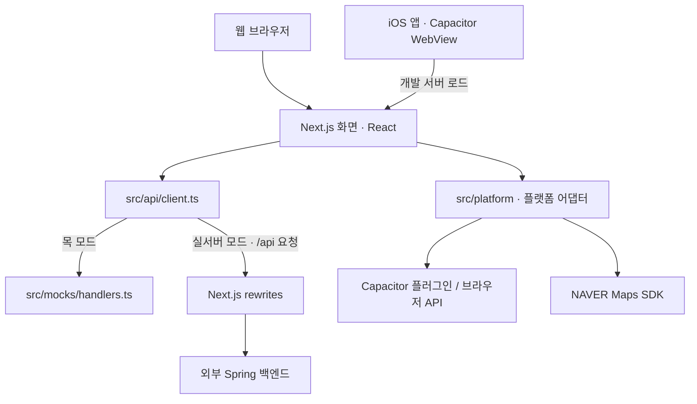
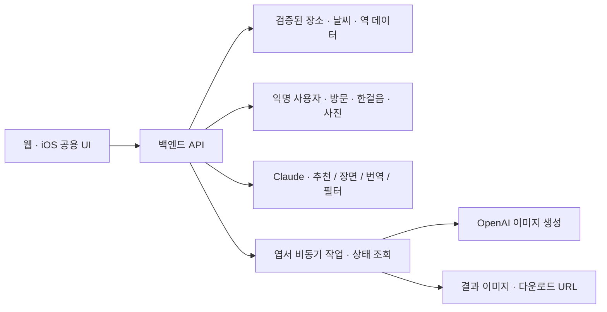

# 서대문 발자취 — 프로젝트 및 아키텍처

작성 기준: 2026-11-06. 현재 저장소의 코드와 요구사항을 대조한 문서다. **구현 현황**과 **목표 구조**를 구분하며, 백엔드 구현 여부는 이 프런트엔드 저장소만으로 확인하지 않는다.

## 1. 문서와 디자인 참조

- [기획안·요구사항 v2](../../요구서.md): 서비스 범위, F1~F7, 비기능 요구사항, P0 API의 기준. 프로젝트 상위 디렉터리에 있으며 프런트엔드 폴더만 복사하면 링크 대상도 별도로 제공해야 한다.
- [Figma 디자인 — ui_final](https://www.figma.com/design/LiOMcefG48DP23YjkXeLgg/Untitled?node-id=9-268): 화면·비주얼의 기준. `ui_ref`(0:1 페이지)는 이전 와이어프레임이다.
- [하네스 엔지니어링](HARNESS_ENGINEERING.md): 개발자·에이전트의 작업 규칙과 검증 기준.
- [도보 경로안내 — 백엔드 전달](ROUTE_GUIDANCE_BACKEND.md): 경로 조회 API와 서버 처리 로직에 대한 미구현 협의안.
- [루트 AGENTS.md](../AGENTS.md): Next.js 변경 전 설치된 버전의 문서를 확인하도록 하는 필수 작업 지침.

화면은 Figma `ui_final` 페이지(9:268)의 402px 프레임을 기준으로 구현했다.

## 2. 서비스 개요와 범위

서대문에 온 외국인 유학생이 지금에 맞는 장소를 추천받고, 모국어와 쉬운 한국어로 장소를 이해하며, 방문 도장·한 줄 후기인 **한걸음**·회고 엽서를 남기는 서비스다. 코드의 앱 이름은 `Seoul Storywalk`, 요구서의 서비스 이름은 `서대문 발자취(가칭)`다.

핵심 경험은 **처음 설정 → 지금 추천 → 맞춤 장면 → 현장 해설 → 방문 기록 → 흔적 지도·한걸음 → 회고 엽서**다. TTS, 장면 삽화, 단어장, 가족용 공유 페이지는 MVP 범위 밖이다. 위치 알림은 요구서에서 발표·확장 항목이며, 현재 알림 테스트 코드가 있어도 MVP 필수 기능으로 간주하지 않는다.

## 3. 현재 구현 현황

Figma ui_final의 화면을 구현했고(2026-11-06), BE `docs/api.md` 기준으로 P0 API에 연동했다.

| 화면 (Figma) | 경로 | 연동 API |
| --- | --- | --- |
| 00 온보딩·시작 선택 | `/start` | 로그인 전이면 Providers가 보냄. 로고 1.5초 뒤 시작 화면. 가입하기 → N1, 로그인 → `/login` (로그인 링크는 Figma에 없지만 기존 사용자용으로 유지) |
| 로그인 | `/login` | `POST /auth/login` (N1과 같은 구성요소로 추가한 화면) |
| N1 가입 | `/signup` | 아이디·비밀번호 입력, `GET /auth/check-id`. 서버 필수값 name에는 아이디를 넣는다. 입력은 `store/signup.ts`(메모리) |
| N2 취향 선택 | `/preferences` | 서버 계약 없음, 기기에만 저장 |
| 01 처음 설정 | `/setup` | 국적·언어와 함께 `POST /auth/signup` → 토큰 저장 |
| 03 지금 (홈) | `/` | 위치 1회 → `GET /now`. 시연용 `?weather=RAINY&time=15:00&stationId=` 전달 |
| 04 장면 | `/scene/[placeId]` | `POST /scenes`(다른 나라 시선 = nationality 바꿔 재요청), 최신 한걸음 `GET /places/{id}/reviews?limit=1` |
| 05 현장 해설 | `/explain` | `GET /places/nearby`, "여기 없어요" 검색은 `GET /map/pins` 목록 |
| 06 해설 결과·도장 | `/visit/[placeId]` | `POST /explanations`, 진입 시 `POST /visits`(코스·다음 장소) |
| N3 한걸음 작성 | `/visit/[placeId]/review` | `POST /photos` → `POST /places/{id}/reviews`(JSON), 422 `REVIEW_INAPPROPRIATE` |
| 07 흔적 지도 | `/map` | `GET /map/pins`(국적 필터는 화면에서 계산), `GET /places/{id}/reviews` |
| 08 나의 기록 | `/log` | `GET /users/{userId}/visits` |
| 09·10 회고 엽서 | `/postcard`, `/postcard/result` | 사진 1장 `POST /photos` → `POST /postcards` → `GET /postcards/{id}` 1.5초 폴링. 프레임·소감은 서버가 합성한 이미지를 그대로 표시 |
| 11 나의 발자취 | `/journey` | `GET /users/{userId}/visits`로 기간·도장·완주 코스·순간들을 계산(`lib/journey.ts`). 08 제목 옆 링크로 진입. 한걸음 수·마지막 한 줄은 기기 저장 |

- 인증: 토큰은 `store/user.ts`(localStorage)에 두고 `setAccessToken`으로 모든 요청에 붙인다. 앱 실행 시 `GET /users/me`로 자동 로그인하고, 401이면 토큰을 지우고 `/start`로 보낸다(`setUnauthorizedHandler`).
- 코드값: 화면 국적(네팔·기타)과 UI 언어(vi…)는 `api/codes.ts`에서 API 값(OTHER, VI…)으로 바꾼다.
- 서버에 없는 화면 요소: 07 '이번 주' 필터(기간 집계 없음), 09 소감 번역 줄(번역 API 없음), 11 AI 이야기(고정 문장으로 대체, 제목도 '나의 이야기'), 11 한걸음 수(작성자를 내보내지 않아 이 기기에서 남긴 수만 집계), 01 프랑스어(API 언어 없음). 영국·프랑스 국적은 OTHER로 보낸다.
- 장소 사진: 형무소·독립문·영천시장은 `public/images`의 Figma 사진을 먼저 쓰고 나머지는 서버 이미지를 쓴다(`lib/placeImage.ts`).
- 실내 시연에서 도장을 받으려면 `NEXT_PUBLIC_DEMO_STAMP_AT_PLACE=true`(장소 좌표 전송).

`motion`은 `PeekSheet`에서 쓴다. 화면 문구는 UI 번역 사전을 거치고, 화면 선택지는 `src/lib/options.ts`에 있다.

## 4. 기술 구성

버전은 `package.json` 선언 기준이며, `^` 표기가 있는 패키지의 실제 설치 버전은 잠금 파일과 다를 수 있다.

| 영역 | 기술 | 역할 |
| --- | --- | --- |
| 웹 | Next.js `16.4.5`, React·React DOM `19.3.0` | App Router, 공통 레이아웃, 화면 렌더링 |
| 언어·스타일 | TypeScript `^5`, Tailwind CSS `^4` | 엄격한 타입 검사, 유틸리티 스타일 |
| 서버 상태 기반 | TanStack React Query `^5.106.1` | 향후 조회·변경·캐시 관리. 현재 Provider 설정만 존재 |
| 클라이언트 상태 | Zustand `^5.0.16` | 익명 사용자 정보의 로컬 저장 |
| 네이티브 | Capacitor `^8.6.0` 및 플러그인 | iOS WebView와 위치·카메라·알림·공유 브리지 |
| 지도 | NAVER Maps JavaScript SDK, `@types/navermaps` | 지도·파노라마, 좌표 변환 |
| 패키지 관리 | pnpm `12.16.1` | `packageManager`에 지정된 도구 |
| 코드 검사 | ESLint `^9`, Next.js ESLint 설정 | 코드 규칙 검사 |

## 5. 현재 실행 구조



### 화면과 클라이언트 경계

- `src/app/layout.tsx`: 서버 컴포넌트로 메타데이터, Noto Sans KR, 모바일 너비(`max-w-md`), safe-area 여백을 구성한다.
- `src/app/providers.tsx`: 클라이언트 컴포넌트로 QueryClient와 알림 탭 리스너를 등록한다. 쿼리 재시도는 1회, 창 포커스 시 재조회는 끈 상태다.
- `src/app/page.tsx`: 03 지금(홈). 익명 사용자가 없으면 `/start`로 보낸다(스토어 복원 후 판단).
- `src/app/dev/setup-check/page.tsx`: 기존 API·위치·알림 테스트 화면(원래 `/`).
- `src/app/dev/map-check/page.tsx`: 근사 좌표 3곳으로 지도·마커·폴리라인·파노라마를 검증한다. 실제 코스 데이터가 아니다.

화면 이벤트와 `useEffect`에서 브라우저·기기 기능을 호출한다. 클라이언트 컴포넌트도 사전 렌더링될 수 있으므로 `window`·`navigator` 접근을 서버 실행 경로에 두지 않는다.

### API와 목 모드

`api<T>(path, init)`은 `/health`처럼 **`/api`를 제외한 경로**를 받는다.

1. `NEXT_PUBLIC_USE_MOCK === "true"`면 목 모듈을 동적 import한다. 그 외에는 실서버 모드다.
2. 실서버 모드에서는 `/api${path}`로 `fetch`한다.
3. Next.js가 `/api/:path*`를 `${API_PROXY_TARGET}/api/:path*`로 프록시한다. 기본 대상은 `http://localhost:8080`이다.
4. 공통 응답 `{ resultType, httpStatusCode, code, message, data }`에서 `data`를 반환한다.
5. HTTP 실패·JSON 응답 부재·`resultType === "FAILURE"`이면 `ApiError(status, code, message)`를 던진다. 네트워크 자체의 실패는 `fetch` 오류로 전달된다.

JSON 요청에는 기본 `Content-Type: application/json`을 넣고, `FormData`에서는 브라우저가 multipart 경계를 설정하도록 한다. 제네릭 타입은 런타임 응답 검증을 대신하지 않는다.

목은 HTTP 서버나 MSW가 아니라 함수 기반 분기다. 약 300ms 지연 후 `GET /health`, `POST /users`만 응답한다. 쿼리 문자열은 라우트 매칭에서 제거되며, 사용자 생성 결과는 입력과 무관한 고정값이다. 등록되지 않은 요청은 오류가 난다. 따라서 목 성공만으로 백엔드 계약이나 국적별 생성 동작을 검증할 수 없다.

### 상태와 번역

| 상태 종류 | 위치 | 현재 동작 |
| --- | --- | --- |
| 화면 일시 상태 | 페이지의 React state·ref | 검증 로그, SDK 준비 상태 등 |
| 사용자 상태 | `src/store/user.ts` | `userId`, `nationality`, `language`를 `storywalk-user` 키로 localStorage에 유지. `setUser`, `reset` 제공 |
| 서버 상태 | `src/app/providers.tsx` | QueryClient 기반만 있음. 영속 캐시는 설정되지 않음 |
| UI 번역 | `src/i18n/messages.ts`, `src/i18n/index.ts` | 한국어 원문을 키로 쓰는 5개 언어 고정 사전. `useT()`로 표시. 언어 선택 전에는 기기 언어, 미지원 기기 언어는 영어로 표시 |

장소 이야기·해설·후기 번역은 요구서상 백엔드 책임이다. 클라이언트 번역 사전에 생성 콘텐츠를 저장하는 구조가 아니다. UI 사전은 언어 설정에서 선택 가능한 5개 언어와 한국어를 지원한다. 번역은 LLM으로 미리 생성해 저장소에 두고, 앱 실행 중에는 LLM을 호출하지 않는다. 시연 언어의 번역문은 사람이 검수한다. 생성 콘텐츠의 지원 언어 범위와 두 번째 시연 국적은 추가 합의가 필요하다.

### 플랫폼 어댑터

| 모듈 | iOS 네이티브 | 웹 |
| --- | --- | --- |
| `location.ts` | Capacitor Geolocation | `navigator.geolocation` |
| `camera.ts` | 카메라·앨범 선택 후 `Blob` 반환 | 이미지 파일 입력 후 `Blob` 반환 |
| `notify.ts` | 권한 요청 후 로컬 알림 예약, 탭 리스너 | 알림 예약·리스너 모두 실동작 없음 |
| `share.ts` | 캐시에 이미지 저장 후 공유 시트 | `postcard.png` 다운로드 |
| `map.ts` | WebView에서 NAVER JS SDK | 브라우저에서 같은 SDK |

위치는 고정밀·10초 제한의 **단발성 조회**다. 자동 근접 감지나 백그라운드 추적은 없다. `notifyNearby`라는 이름과 달리 위치를 판단하지 않고 기본 3초 뒤 알림을 예약한다.

지도 SDK 로더는 `window`에 준비 상태와 로딩 Promise를 유지해 Fast Refresh 중 스크립트 중복 주입을 줄인다. 파노라마 서브모듈 콜백으로 준비 완료를 확인하고 인증 실패 이벤트를 전달한다. 경로 좌표는 `[경도, 위도]`이며 `toLatLng()`에서만 네이버의 `(위도, 경도)`로 바꾼다.

## 6. 요구사항 기반 목표 구조

아래 내용은 **앞으로 구현할 책임 분리**다. 현재 API·AI 기능이 완성되었다는 의미가 아니다.



프런트엔드는 입력·권한·화면 상태·API 요청·표시를 담당한다. 백엔드는 추천 후보 제한, AI 호출, 저장, 방문 검증, 후기 필터, 번역 캐시, 엽서 작업 상태를 담당하는 방향이다. 실제 서버 내부의 DB·큐·스토리지 제품과 요청 필드·상태 열거형은 요구서에 없으므로 이 문서에서 확정하지 않는다.

서비스별로 지켜야 할 데이터 원칙은 다음과 같다.

- **F2**: 시간·날씨·위치로 먼저 후보를 제한하고 AI가 후보 중에서 고른다. 앱 진입·복귀 시 위치를 한 번 받으며 지속 추적하지 않는다.
- **F3**: 검증된 장소 근거로 모국어·쉬운 한국어와 국적별 한 줄 연결을 만든다. 국적을 바꾸어 재생성할 수 있어야 한다.
- **F4**: 사진과 선택한 장소를 보내고 저장된 해설을 번역한다. 사진만으로 역사적 사실을 새로 생성하는 기능으로 바꾸지 않는다. 번역은 장소·언어별로 캐싱한다.
- **F5**: 도장은 장소 근접 여부를 검증한 뒤 저장한다. 허용 반경·거리 계산 책임·중복 방문 정책은 별도 계약이 필요하다.
- **F6**: 공개 지도에는 장소별 집계만 표시한다. 후기 저장 전에 욕설·광고를 걸러내며, 개인 좌표·개별 방문 시각은 노출하지 않는다.
- **F7**: 사진 1장·소감으로 비동기 생성을 시작하고 상태 조회로 결과를 받는다. 별도 가족 공유 페이지 없이 다운로드 결과를 사용한다.
- 위치는 추천·해설 및 방문 확인에 필요한 계산에만 일시 사용하고 저장하지 않는 방향으로 계약을 확인한다. 개인 방문 기록과 공개 지도 집계는 구분한다.

### P0 API 대응표

다음은 요구서의 **연동 예정 계약**이다. 실서버의 구현·가용성을 확인한 목록이 아니다. 클라이언트 호출 시 아래 경로에서 `/api`를 제외한다.

| 기능 | 메서드·경로 | 현재 목 |
| --- | --- | --- |
| 공통 | `GET /api/health` | 있음 |
| F1 | `POST /api/users` | 고정 응답 |
| F1 | `GET /api/users/{userId}` | 없음 |
| F2 | `GET /api/now` | 없음 |
| F3 | `POST /api/scenes` | 없음 |
| F4 | `GET /api/places/nearby` | 없음 |
| F4 | `POST /api/explanations` | 없음 |
| F4·F6·F7 | `POST /api/photos` | 없음 |
| F5 | `POST /api/visits` | 없음 |
| F5 | `GET /api/users/{userId}/visits` | 없음 |
| F6 | `GET /api/map/pins` | 없음 |
| F6 | `GET /api/places/{placeId}/reviews` | 없음 |
| F6 | `POST /api/places/{placeId}/reviews` | 없음. 부적절한 내용은 요구서상 422 |
| F7 | `POST /api/postcards` | 없음 |
| F7 | `GET /api/postcards/{postcardId}` | 없음 |

## 7. 디렉터리와 변경 책임

```text
storywalk-fe/
├── AGENTS.md                  # Next.js 작업 지침
├── docs/                      # 아키텍처·하네스 문서
├── src/
│   ├── app/                   # 페이지·레이아웃·Provider·전역 CSS
│   │   └── dev/map-check/     # 지도·거리뷰 검증 페이지
│   ├── api/client.ts          # 공통 HTTP·목 분기·오류
│   ├── store/user.ts          # 익명 사용자 로컬 상태
│   ├── i18n/index.ts          # UI 문구
│   ├── mocks/handlers.ts      # 개발용 목 응답
│   └── platform/             # 지도·위치·카메라·알림·공유
├── ios/App/                   # Xcode 프로젝트·Capacitor 브리지
├── .env.example               # 공개 가능한 설정 예시
├── next.config.ts             # API 프록시
├── capacitor.config.ts        # 앱 식별자·개발 서버·webDir
└── package.json               # 스크립트·의존성·pnpm 버전
```

화면 공용 UI는 `src/components/ui`, 화면 간 공용 조각은 `src/components/{course,map}`, 재사용 흐름은 `src/hooks`, 일시 상태는 `src/store/{capture,postcard}.ts`에 둔다. 도메인별 API 모듈은 아직 없다. 기능 개발 시 실제 재사용과 책임에 맞추어 추가하며, 문서의 목표만을 위해 빈 계층을 만들지 않는다. `@/*` 별칭은 `src/*`를 가리킨다.

## 8. 개발 환경과 실행

```bash
pnpm install
cp .env.example .env.local
pnpm dev
```

`.env.local`이 이미 있으면 복사 명령으로 덮어쓰지 말고 필요한 항목만 보완한다. 웹 진입점은 `http://localhost:3000`, 지도 검증은 `/dev/map-check`다.

| 변수 | 용도·주의 |
| --- | --- |
| `NEXT_PUBLIC_USE_MOCK` | 문자열 `true`만 목 모드. 템플릿은 `true` |
| `API_PROXY_TARGET` | Next.js가 사용하는 서버 전용 백엔드 주소. 기본 `http://localhost:8080` |
| `NEXT_PUBLIC_NAVER_MAP_KEY_ID` | 공개 Maps Application Client ID. NCP 계정 인증키와 다름. Maps Web 서비스 URL 등록 필요 |
| `SKT_ACCESS_KEY_ID` | 서버 전용 예비 설정. 현재 코드에서 미사용 |
| `CAP_ENV` | Capacitor CLI 실행 환경. 기본 `dev`. Next.js의 `.env.local` 로딩에 기대지 않고 실행 시 지정 |

`NEXT_PUBLIC_*` 값은 클라이언트 번들에 노출되며 빌드 시 반영된다. 비밀키를 넣지 않는다. 설정 변경 후 개발 서버를 재시작하고, 배포 값 변경은 재빌드한다. 목 모드는 API만 대체하므로 지도 키·위치 권한·네이티브 기능까지 대신하지 않는다.

| 명령 | 역할 |
| --- | --- |
| `pnpm dev` | Next.js 개발 서버 |
| `pnpm build` | 현재 설정의 Next.js 프로덕션 빌드 |
| `pnpm start` | 빌드된 Next.js 서버 실행 |
| `pnpm lint` | ESLint 검사 |
| `pnpm exec tsc --noEmit --incremental false` | 빌드 정보 파일을 갱신하지 않는 타입 검사 |
| `pnpm cap:sync` | `CAP_ENV=dev`로 iOS 동기화 |
| `pnpm ios` | `CAP_ENV=dev`로 동기화 후 Xcode 열기 |

iOS 개발 모드는 `http://localhost:3000`을 WebView에 로드한다. 실제 기기의 `localhost`는 기기 자신이므로 개발 PC 주소·네트워크·허용 URL 설정을 별도로 맞춰야 한다. 일반 모바일 웹의 위치 권한은 HTTPS 환경에서 확인한다. 앱 ID는 `com.storywalk.app`이며 Android 프로젝트는 없다.

### 배포 경계

`capacitor.config.ts`에는 `webDir: "out"`과 `CAP_ENV=bundle` 분기가 있지만, `next.config.ts`에는 `output: "export"`가 없다. **현재 `pnpm build`를 출시용 정적 앱 패키지 생성 절차로 안내하면 안 된다.**

정적 번들로 전환하려면 정적 export 설정·동적 경로 생성·API 연결 방식을 함께 검토해야 한다. Next.js rewrites는 정적 export에서 지원되지 않으므로 현재 `/api` 프록시를 그대로 사용할 수 없다. 저장소에 `out/`이 존재하더라도 최신 소스로 재생성된 출시 산출물임을 보장하지 않는다.

## 9. 요구서·디자인 간 결정 필요 사항

| 주제 | 요구서 v2 | Figma 메타데이터에서 확인한 내용 | 처리 기준 |
| --- | --- | --- | --- |
| 시작·가입 | 국적·언어만 선택, 로그인 없는 익명 시작 | `00 시작 선택`, `N1 가입 (선택)`, `N2 취향 선택` 추가 | 익명 시작은 요구서 기준. 가입·취향을 P0에 추가할지는 결정 필요 |
| 위치 거부 | 역 선택 대체 경로 필요 | v3.1 피드백에서 역 선택·위치 거부 분기 제거 언급 | 거부 대체 경로 삭제를 확정하지 않는다. 요구 변경 여부 확인 필요 |
| 후기 입력 | 한 줄 후기·사진, 저장 전 필터 | `N3 한걸음 작성` 및 길이·사진 선택 UI | 글자 수·사진 필수 여부·422 오류 형식은 서버 계약 확인 필요 |
| 엽서 대기 | 비동기 생성·대기 상태·상태 조회 | 결과 화면 안 생성 중 상태로 통합하는 피드백 | 대기 상태는 유지하되 별도 페이지 존재를 가정하지 않는다 |

추가로 API 요청·응답 상세 타입, 두 번째 시연 국적, 방문 허용 반경, 엽서 상태·조회 주기·타임아웃은 미확정이다. 이 문서는 해당 값을 임의로 만들거나 제품 기능을 구현하지 않는다.
